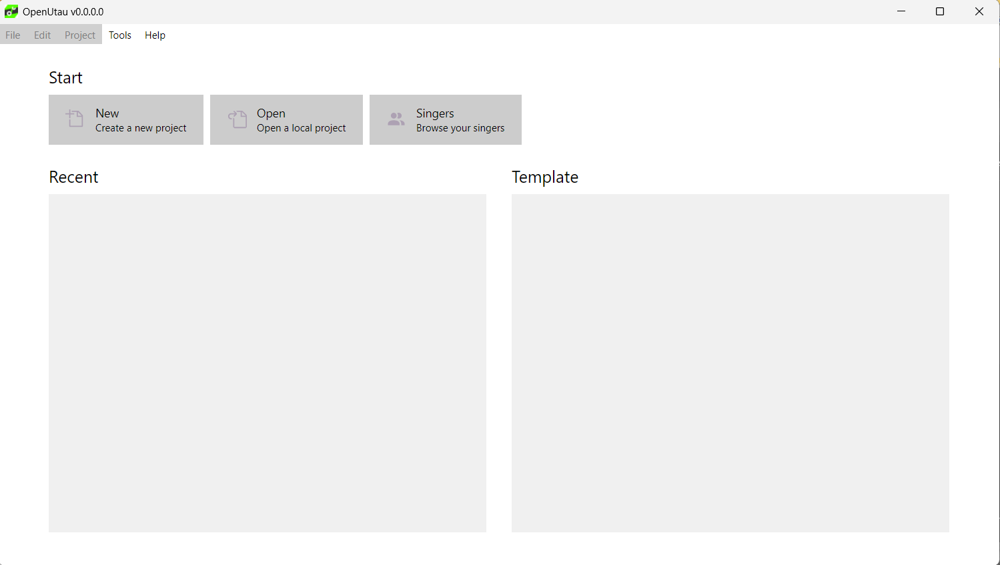
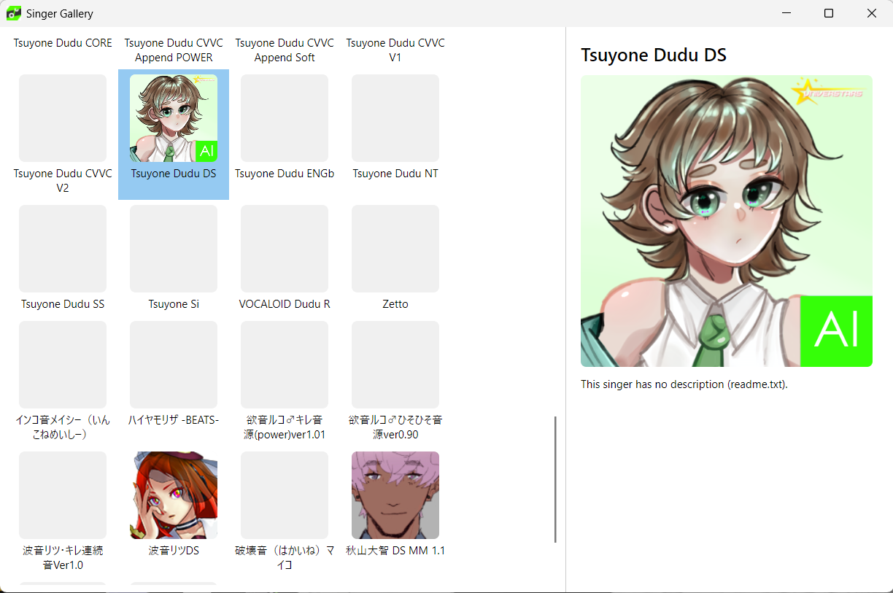
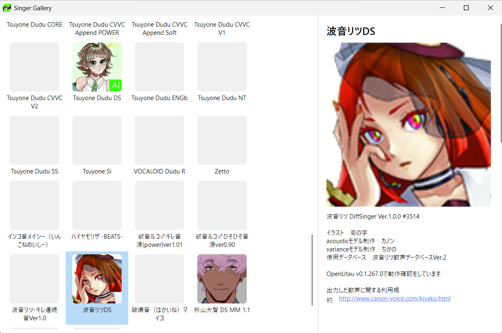
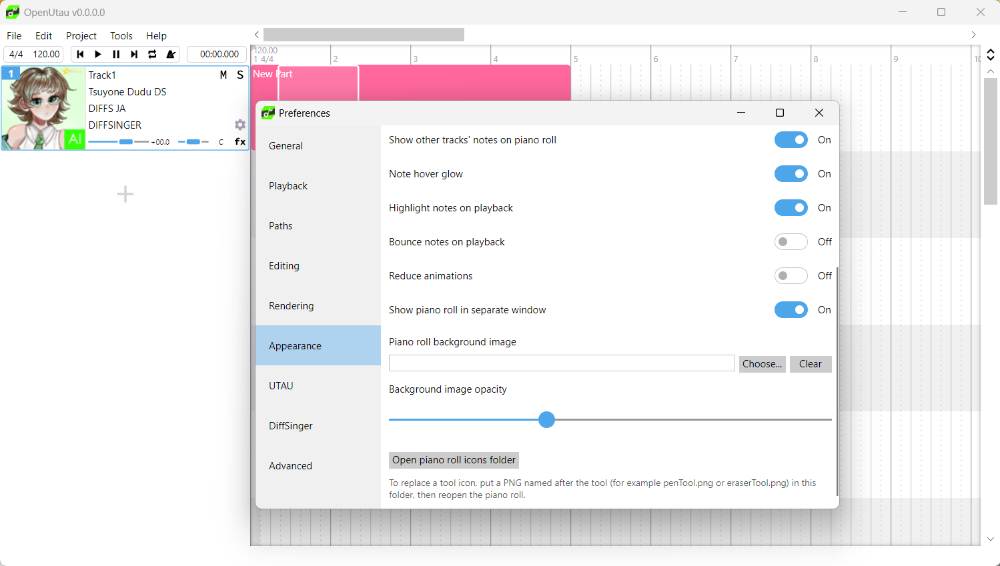
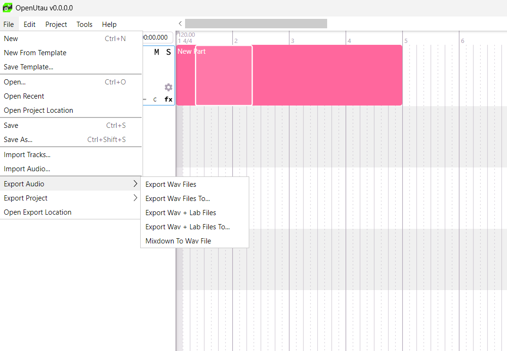

# Dudu_OpenUTAU

  
  

[**English**](#-about-the-project) | [**Português (Brasil/Portugal)**](#-sobre-o-projeto)

---

## 🇺🇸 About the Project

**Dudu_OpenUTAU** is a custom modification (fork) of [OpenUTAU](https://github.com/stutterfly/OpenUTAU) designed to optimize workflow and add extra features for voicebank producers and creators.

### ✨ Key Features & Screenshots

#### 1. Integrated Singers Tab & Gallery
Access your voicebanks directly from the main start menu and browse installed singers with a clean gallery interface.

| Start Screen Menu | Singer Gallery View |
| :---: | :---: |
|  |  |

| Singer Details & Info |
| :---: |
|  |

---

#### 2. Advanced Customization Options
Customize the piano roll interface, appearance, background images, and icon folders directly through the preferences menu.

  

---

#### 3. New Audio Export Method (WAV + LAB)
Easily export projects with generated label files (`.lab`)Alongside `.wav` files for seamless integration with speech and singing processing tools.

  

---

## 🇧🇷 Sobre o Projeto

O **Dudu_OpenUTAU** é um fork personalizado do [OpenUTAU](https://github.com/stutterfly/OpenUTAU), focado em melhorar o fluxo de trabalho e trazer novas opções para criadores e utilizadores do programa.

### ✨ Principais Funcionalidades

- 👥 **Aba de Cantores Integrada:** Botão direto no menu principal para abrir a galeria e navegar pelos *voicebanks* instalados.
- 🎹 **Personalização de Interface:** Configurações de imagem de fundo, opacidade e ícones do *piano roll*.
- 📤 **Exportação WAV + LAB:** Novo método no menu *File > Export Audio* para exportar ficheiros de áudio juntamente com as legendas `.lab`.

---

## 🚀 Installation / Instalação

1. Go to the [Releases](https://github.com/Sugar212/Dudu_OpenUTAU/releases) section.
2. Download the latest release build for your operating system.
3. Extract the `.zip` archive and launch the executable.

---

## 🤝 Contributing

Contributions, bug reports, and suggestions are welcome! Feel free to open an [Issue](https://github.com/Sugar212/Dudu_OpenUTAU/issues) or submit a Pull Request.

---

## 📜 License

This project is open-source and inherits the licensing terms from [OpenUTAU](https://github.com/stutterfly/OpenUTAU) (MIT License).
